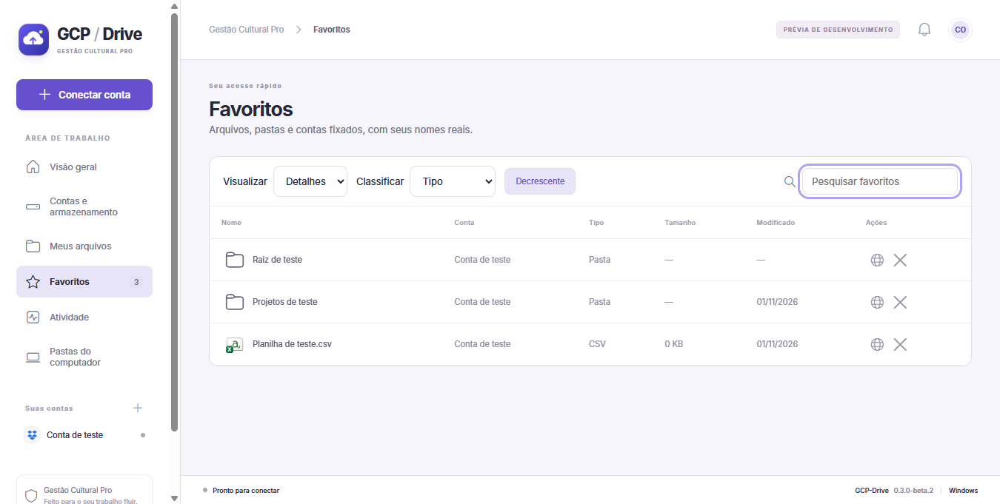
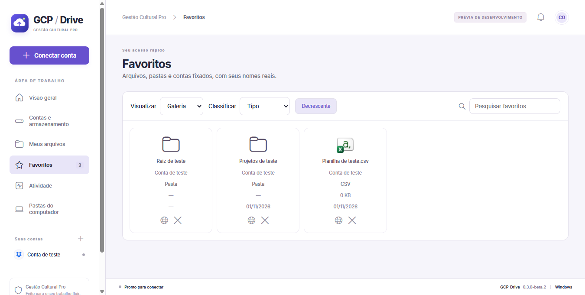

# GCP-Drive

**Suas nuvens, no seu computador.** Cliente desktop multicloud com interface gráfica, identidade roxa e software livre sob [GPL-3.0](LICENSE).

Desenvolvido por **Bruno Albertini | [Gestão Cultural Pro](https://gestaoculturalpro.com.br)**.

## Download

[Baixe os instaladores na página de versões](https://github.com/cliqueprojeto/GCP-Drive/releases).

| Sistema | Arquitetura | Pacotes |
|---|---|---|
| Windows | x64 | EXE |
| Linux | x64 | DEB, RPM e AppImage |
| Arch Linux | x86_64 | Pacote pacman e receita compatível com AUR — [instalação](docs/ARCH-LINUX.md) |
| macOS Intel | x64 | DMG |
| macOS Apple Silicon, incluindo M1 | arm64 | DMG |

**0.3.0-beta.2 é uma prévia para testes.** Compilação e testes automatizados não substituem homologação com contas reais, aplicativos externos e gerenciadores de arquivos. Consulte [requisitos](docs/REQUISITOS.md) e [validação](docs/VALIDACAO.md). Os aplicativos ainda não possuem assinatura de distribuição Windows nem assinatura/notarização Apple.

## Funcionalidades

- Google Drive, OneDrive e Dropbox com autorização pelo navegador; MEGA e Proton Drive com autenticação direta. **Proton Drive é experimental**, com possíveis incompatibilidades de autenticação.
- Múltiplas contas, com identidade, configuração e cache separados; alteração do nome sem refazer o login.
- Streaming por unidades virtuais com cache local, usando rclone como motor. Abertura e edição em aplicativos instalados pelo caminho montado.
- Google: composição de Meu Drive, Compartilhados comigo e drives compartilhados acessíveis à conta; atualização pela interface.
- Navegação em abas, Detalhes/Lista/Galeria, classificação, pesquisa, renomeação e download. Compartilhamento abre o provedor para escolher permissões.
- Favoritos com nomes reais, classificações, busca e remoção rápida.
- Página própria de contas e armazenamento; inspeção e limpeza protegida do cache, com bloqueio quando há gravações pendentes.
- Sincronização bidirecional de pastas do computador, prévia antes da primeira execução, pausa e remoção do vínculo sem excluir arquivos de origem.
- Histórico de atividades, indicadores de transferência e bandeja animada. Estado desconhecido não é apresentado como sincronização comprovada.
- Integração Explorer por conta e ações de contexto; extensão opcional Nautilus/Nemo quando o ambiente oferece os bindings necessários. Homologação gráfica por sistema pendente.
- Temas claros/escuros e importação de [temas JSON somente de cores](docs/TEMA-EXEMPLO.json).
- Atualizações pelo canal público GitHub, com verificação SHA-256 antes de oferecer a instalação.
- PT-BR principal, opções inglês/espanhol. Fluxos novos ainda passam por revisão de tradução completa.

## Interface

Capturas com dados fictícios de teste:





## Instalação e montagem

- **Windows:** o EXE inclui o motor e o instalador oficial verificado do WinFsp. O assistente solicita consentimento; o Windows confirma a elevação necessária. Um componente compatível já instalado é reutilizado.
- **Linux:** DEB/RPM declaram dependências; use o gerenciador de pacotes da distribuição. FUSE, acesso a /dev/fuse e cofre Secret Service/KWallet são necessários para as respectivas funcionalidades. Categoria Internet. AppImage não instala essas dependências automaticamente; mantenha o arquivo em caminho estável.
- **macOS:** arraste o aplicativo do DMG para Aplicativos. A montagem depende de suporte compatível e autorizado no sistema. macFUSE, compatibilidade do motor e integração Finder ainda precisam de homologação em Intel e Apple Silicon. Compilar o DMG não comprova a montagem.

Configuração de autenticação criptografada e chave protegida pelo cofre do sistema. O armazenamento inseguro basic_text é bloqueado no Linux. O cache de arquivos e o índice de nomes **não** possuem criptografia adicional de conteúdo. A desinstalação Windows pergunta se deve remover configurações e cache; essa opção não apaga pastas escolhidas pelo usuário nem arquivos remotos.

## Limitações da prévia

Teste inicialmente com cópias de arquivos. Alterações concorrentes podem produzir conflitos; nenhuma ferramenta garante ausência absoluta deles. A política de pastas preserva versões concorrentes, mas precisa de testes adicionais nos provedores.

Indexação global por Windows Search, Spotlight e Tracker/Baloo, pin offline permanente, gerenciamento de versões e presença confirmada de outros editores ainda não estão concluídos. A busca atual cobre pastas visitadas. Ajustes de cache, listagem e montagem, com medições e análise de motores alternativos, estão em [DESEMPENHO.md](docs/DESEMPENHO.md). [Presença opcional](docs/PRESENCA.md) tem desenho documentado, sem serviço implantado. Exportar Google Docs não equivale a edição nativa bidirecional. Os indicadores de sincronização aparecem no painel do app e, no Linux, como emblemas no Nautilus e no Nemo. Não há extensões nativas para Explorador, Finder ou Dolphin.

## Desenvolvimento

Node **24.22.1** e npm **11.16.0**, conforme .nvmrc e packageManager.

```sh
npm ci
npm run prepare:rclone
npm run build
npm start
```

O preparo baixa rclone 1.75.2 do domínio oficial e valida SHA-256. Binários, configurações e caches locais são ignorados pelo Git.

```sh
npm run typecheck
npm test
npm run test:engine
npm run test:sync
npm run test:desktop
```

Testes de interface usam perfil temporário; testes do motor usam pastas locais, sem autenticar provedores. O workflow compila em Windows, Linux e macOS na arquitetura correspondente. Empacotamento local: prepare o motor e use pack:win, pack:linux ou pack:mac no sistema apropriado.

## Contribuição, privacidade e licenças

Veja [CONTRIBUTING.md](CONTRIBUTING.md), [SECURITY.md](SECURITY.md) e [componentes de terceiros](THIRD_PARTY_NOTICES.md). Não envie credenciais ou dados pessoais em issues.

## Apoie o projeto

O apoio é voluntário; as funcionalidades não dependem de contribuição. O aplicativo oferece PIX com QR Code e [contribuição via Stripe](https://donate.stripe.com/fZu4gzeBSfhbd7451F6Ri00).
