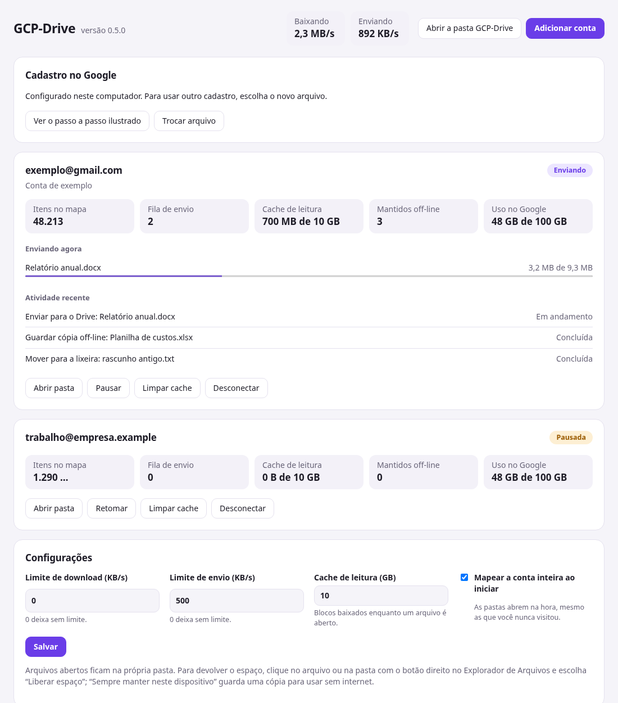
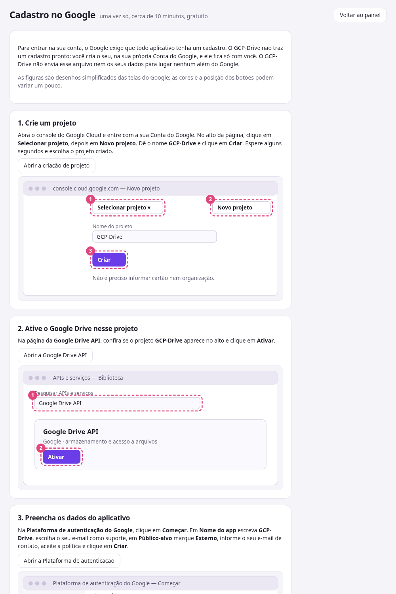

# GCP-Drive

**O seu Google Drive como uma pasta do computador, no Linux e no Windows.** Os arquivos aparecem na hora e só são baixados quando você abre. Software livre sob a licença [GPL-3.0](LICENSE), com o código aberto para quem quiser conferir.

Desenvolvido por **Bruno Albertini | [Gestão Cultural Pro](https://gestaoculturalpro.com.br)**.



*Painel do Windows com contas e arquivos de exemplo.*

## Baixar

[**Baixe a versão 0.5.2 na página de versões**](https://github.com/cliqueprojeto/GCP-Drive/releases/latest).

| Sistema | Arquivo |
|---|---|
| Windows 10 e 11 (64 bits) | `GCP-Drive-0.5.2-instalador.exe` |
| Debian, Ubuntu, Mint | `gcp-drive_0.5.2-1_amd64.deb` |
| Fedora | `gcp-drive-0.5.2-1.x86_64.rpm` |
| Arch, Manjaro, BigLinux | `gcp-drive-0.5.2-1-x86_64.pkg.tar.zst` |

Cada versão traz os códigos SHA-256 para conferir os arquivos baixados.

## O que o GCP-Drive faz

### No Linux e no Windows

- **Várias contas do Google ao mesmo tempo.** Cada conta vira uma pasta dentro de `GCP-Drive`, na sua pasta pessoal.
- **Arquivos sob demanda.** A pasta mostra tudo o que está no Drive sem ocupar espaço; o arquivo é baixado quando você abre, e só as partes necessárias. Vídeos e arquivos grandes começam a abrir sem esperar o download inteiro.
- **Meu Drive, Compartilhados comigo e drives compartilhados** na mesma pasta da conta.
- **Mapa da conta.** O GCP-Drive mapeia as pastas uma vez e depois acompanha só as alterações; com o mapa pronto, as pastas abrem sem esperar a internet.
- **Cache de leitura.** O que já foi aberto fica guardado no computador: a segunda abertura é imediata. O tamanho do cache é ajustável e pode ser limpo pelo painel.
- **Edição direta.** Salve pelo aplicativo que quiser (LibreOffice, Word, editores de imagem). A alteração é enviada alguns segundos depois, como nova versão do mesmo arquivo no Drive.
- **Criar, renomear, mover e excluir** arquivos e pastas. O que é excluído vai para a lixeira do Drive, de onde pode ser recuperado.
- **Proteção contra perda em edições simultâneas.** Se o arquivo mudou no Drive enquanto você editava, a sua versão é guardada como cópia em vez de apagar a outra. Nenhum programa garante ausência total de conflitos; teste primeiro com cópias.
- **Manter off-line.** Escolha arquivos ou pastas para ficarem sempre disponíveis sem internet, e libere o espaço quando quiser.
- **Documentos, Planilhas e Apresentações Google** aparecem como atalhos que abrem no navegador.
- **Painel** com velocidade de download e de envio, fila de envio, progresso do mapa, uso do cache, espaço usado no Google e atividade recente.
- **Limites de velocidade** de download e de envio; abrir arquivos tem prioridade sobre envios e cópias off-line.
- **Menu GCP-Drive no botão direito** do gerenciador de arquivos: pedir ao Gemini, abrir na nuvem, copiar link, compartilhar, adicionar atalho a Meu Drive, manter off-line, abrir a pasta e enviar arquivo para uma pasta.
- **Compartilhamento** numa janela própria: convidar pessoas ou grupos por e-mail, escolher a permissão, ver quem tem acesso e copiar o link.
- **Marcas de estado** ao lado de cada arquivo e pasta: só na nuvem, neste computador, mantido off-line ou enviando.
- **Busca** nos arquivos da conta e **envio de arquivos** pelo painel.
- **Pausar e retomar** cada conta. **Início junto com o sistema** e ícone na área de notificação.
- **Sem servidores do GCP-Drive.** O aplicativo conversa só com o Google; os seus arquivos e logins não passam por nenhum outro lugar.

### Só no Linux

- Pasta montada em `~/GCP-Drive/<e-mail>`, usável por qualquer programa e pelo terminal.
- Menu e marcas de estado no Dolphin (KDE Plasma 6), Nautilus e Nemo. As marcas do Dolphin vêm de um plugin do KDE Frameworks 6 instalado com o pacote; em distribuições com Qt mais antigo que o da compilação, o Dolphin não carrega o plugin e as pastas funcionam sem as marcas.

### Só no Windows

- Integração com o Explorador de Arquivos: a conta aparece no painel de navegação, com os ícones de estado do Windows (na nuvem, neste dispositivo, sincronizando).
- **Sempre manter neste dispositivo** e **Liberar espaço** no botão direito, como no OneDrive.
- O submenu **GCP-Drive** aparece só para itens dentro da pasta GCP-Drive. No Windows 11 ele pode ficar em **Mostrar mais opções**, conforme a versão do Windows.
- Painel com o mesmo desenho do Linux: início, atividade, notificações, contas, preferências, espaço usado e apoio ao projeto.
- Instalação só para o seu usuário, sem pedir senha de administrador, e desinstalação limpa em **Aplicativos instalados**.

## Como instalar

### Windows

1. Baixe `GCP-Drive-0.5.2-instalador.exe`.
2. O navegador pode avisar que o arquivo "não é baixado com frequência". Escolha **Manter**.
3. Ao abrir o instalador, o Windows pode mostrar a tela azul **"O Windows protegeu o computador"**. Clique em **Mais informações** e depois em **Executar assim mesmo**.
4. Siga o instalador. O GCP-Drive abre sozinho e passa a iniciar junto com o Windows.

O aviso do passo 3 aparece porque o instalador não tem assinatura digital, um certificado pago que programas gratuitos geralmente não têm. Não é sinal de vírus: o código está neste repositório e o instalador é gerado a partir dele, de forma automática, pelo GitHub.

### Linux

Baixe o pacote da sua distribuição e, na pasta do download, instale:

```sh
sudo apt install ./gcp-drive_0.5.2-1_amd64.deb
```

```sh
sudo dnf install ./gcp-drive-0.5.2-1.x86_64.rpm
```

```sh
sudo pacman -U ./gcp-drive-0.5.2-1-x86_64.pkg.tar.zst
```

Use só a linha do seu sistema: a primeira é para Debian, Ubuntu e Mint; a segunda, para Fedora; a terceira, para Arch, Manjaro e BigLinux. Depois abra **GCP-Drive** no menu de aplicativos, categoria Internet.

## Conectar a sua conta do Google

O Google exige que todo aplicativo que acessa o Drive tenha um cadastro. O GCP-Drive **não traz um cadastro pronto**: cada pessoa cria o seu, de graça, na própria Conta do Google. Leva cerca de 10 minutos, é feito uma vez só e o arquivo do cadastro fica apenas no seu computador.

**[Passo a passo ilustrado para criar o cadastro](docs/CADASTRO-GOOGLE.md)**



### O aviso "O Google não verificou este app"

No primeiro login, o Google mostra esse aviso. **Ele é esperado e não indica problema.** Aparece porque o cadastro é seu e não passou pela verificação do Google, um processo pago e voltado a empresas. Para continuar:

1. Clique em **Avançado**.
2. Clique em **Acessar GCP-Drive (não seguro)**.
3. Confira a conta e clique em **Continuar**.
4. **Marque a caixa** de acesso aos arquivos do Google Drive e clique em **Continuar**.

O "desenvolvedor" citado no aviso é o e-mail de quem criou o cadastro, ou seja, o seu. O acesso é concedido ao seu próprio cadastro, no seu computador.

## Segurança e privacidade

- **Código aberto.** Todo o código do aplicativo está neste repositório, em [`native/`](native/), para quem quiser auditar.
- **Sem chaves no repositório.** O repositório e os instaladores não contêm cadastros do Google, senhas nem logins de ninguém.
- **Logins só no seu computador.** As autorizações das contas ficam em arquivos privados do seu usuário e são usadas apenas para falar com o Google.
- **Sem coleta de dados.** O GCP-Drive não tem servidor próprio, telemetria nem anúncios.
- O cache de leitura fica na sua pasta de usuário, sem criptografia adicional; use a criptografia de disco do sistema se o computador for compartilhado.

## O que foi testado

O registro completo, com o que foi e o que não foi executado, está em [docs/VALIDACAO.md](docs/VALIDACAO.md). Em resumo:

- **Linux:** usado no BigLinux/KDE com contas reais (leitura, gravação e instalação do pacote `.pkg.tar.zst`). Os pacotes `.deb` e `.rpm` foram conferidos por dentro, mas ainda não instalados no Debian/Ubuntu e no Fedora.
- **Windows:** os testes automáticos rodam no Windows Server do GitHub contra um Google Drive simulado, incluindo instalar, atualizar e desinstalar. A homologação numa área de trabalho real, com contas reais, ainda está em andamento.

É uma versão nova: comece com arquivos que tenham cópia e [relate problemas](https://github.com/cliqueprojeto/GCP-Drive/issues), sem enviar dados pessoais.

## Para quem desenvolve

O aplicativo atual é o motor em Go da pasta [`native/`](native/README.md), com FUSE no Linux e a API de Arquivos na Nuvem no Windows. A raiz do repositório guarda também o cliente anterior, em Electron, que não é mais distribuído.

```sh
cd native
go vet ./... && go test -race ./...
./package.sh
```

Veja [CONTRIBUTING.md](CONTRIBUTING.md), [SECURITY.md](SECURITY.md) e os [componentes de terceiros](THIRD_PARTY_NOTICES.md).

## Apoie o projeto

O GCP-Drive é gratuito e o apoio é voluntário: PIX pelo painel do aplicativo ou [contribuição via Stripe](https://donate.stripe.com/fZu4gzeBSfhbd7451F6Ri00).
