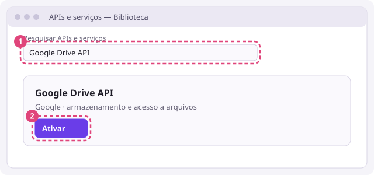
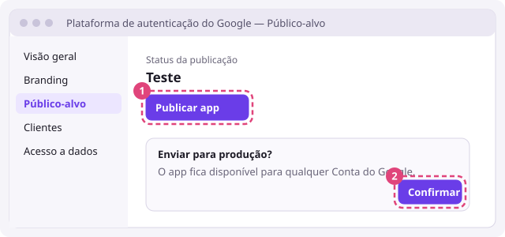
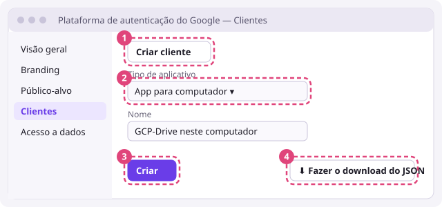
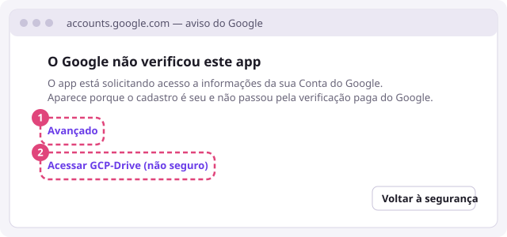
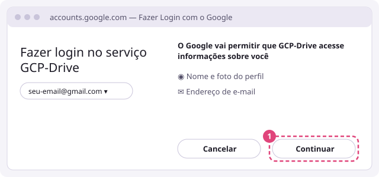
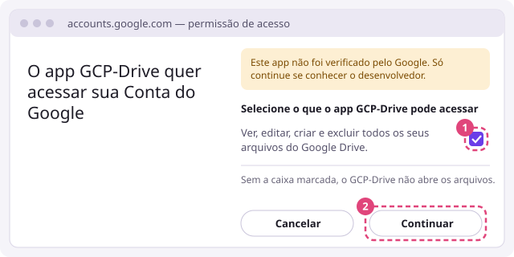

# Cadastro no Google para o GCP-Drive

Para entrar numa Conta do Google, o Google exige que todo aplicativo tenha um cadastro. O instalador do GCP-Drive não traz um cadastro pronto: cada pessoa cria o seu, gratuitamente, na própria Conta do Google. Leva cerca de 10 minutos e é feito uma vez só. No Windows, o mesmo passo a passo está dentro do aplicativo, no painel, em **Cadastro no Google › Ver o passo a passo ilustrado**, com botões que abrem cada página. No Linux, o painel abre esta página pelo botão **Ver o passo a passo**.

O arquivo do cadastro fica só no seu computador. Ele identifica o seu cadastro e não deve ser publicado.

As figuras são desenhos simplificados das telas do Google; cores e posição dos botões podem variar.

## 1. Crie um projeto

Abra <https://console.cloud.google.com/projectcreate> e entre com a sua Conta do Google. No alto da página, clique em **Selecionar projeto** e em **Novo projeto**. Dê o nome **GCP-Drive** e clique em **Criar**. Espere alguns segundos e escolha o projeto criado. Não é preciso informar cartão.

## 2. Ative o Google Drive nesse projeto

Abra <https://console.cloud.google.com/apis/library/drive.googleapis.com>, confira se o projeto **GCP-Drive** aparece no alto e clique em **Ativar**.

## 3. Preencha os dados do aplicativo

Abra <https://console.cloud.google.com/auth/overview> (Plataforma de autenticação do Google) e clique em **Começar**. Em **Nome do app** escreva **GCP-Drive**, escolha o seu e-mail como suporte, em **Público-alvo** marque **Externo**, informe o seu e-mail de contato, aceite a política e clique em **Criar**.

## 4. Publique o aplicativo

No menu **Público-alvo**, clique em **Publicar app** e confirme. Sem este passo o Google desconecta a conta a cada 7 dias. Não é preciso pedir a verificação ao Google.

## 5. Crie o cliente e baixe o arquivo

No menu **Clientes**, clique em **Criar cliente**. Em **Tipo de aplicativo** escolha **App para computador**, dê um nome qualquer e clique em **Criar**. Na janela que aparece, clique em **Fazer o download do JSON**. O arquivo vai para a pasta Downloads, com um nome que começa com `client_secret`.

## 6. Entregue o arquivo ao GCP-Drive

**Windows:** no painel do GCP-Drive, no quadro **Cadastro no Google**, clique em **Escolher arquivo** e selecione o arquivo baixado. Depois clique em **Adicionar conta**.

**Linux:** no painel do GCP-Drive, clique em **Conectar conta do Google**. Na janela **Cadastro no Google**, clique em **Escolher arquivo** e selecione o arquivo baixado; o login começa em seguida. Para trocar o cadastro depois, use **Contas › Cadastro no Google**.

## 7. No primeiro login, passe pelo aviso do Google

Ao adicionar uma conta, o navegador abre a página do Google. Escolha a conta e aparece **"O Google não verificou este app"**. É esperado: o cadastro é seu e não passou pela verificação do Google, um processo pago voltado a empresas. O aviso não indica um problema no aplicativo, cujo código é aberto para quem quiser conferir. Se o link vermelho não estiver à vista, clique em **Avançado**; depois clique em **Acessar GCP-Drive (não seguro)**. O desenvolvedor citado no aviso é o e-mail de quem criou o cadastro, ou seja, o seu.

## 8. Confirme a conta

Na tela **Fazer login no serviço GCP-Drive**, confira o e-mail e clique em **Continuar**.

## 9. Marque o acesso ao Drive e continue

Na última tela, **marque a caixa** ao lado de "Ver, editar, criar e excluir todos os seus arquivos do Google Drive" e clique em **Continuar**. Se a caixa ficar desmarcada, a conta entra mas o GCP-Drive não consegue abrir os arquivos. O navegador mostra "Conta conectada" e a pasta da conta aparece no painel.

Cada cadastro não verificado aceita até 100 Contas do Google.

## O que foi conferido

Os nomes das páginas e dos botões foram conferidos na documentação pública do Google em 14 de novembro de 2026 ("Configurar a tela de permissão OAuth" e "Criar credenciais de acesso"). As três telas do login (passos 7 a 9) foram redesenhadas a partir de capturas enviadas pelo autor, sem os dados que elas mostravam. Os passos 1 a 6 não foram feitos de ponta a ponta numa conta, e o Google muda essas telas de tempos em tempos.
